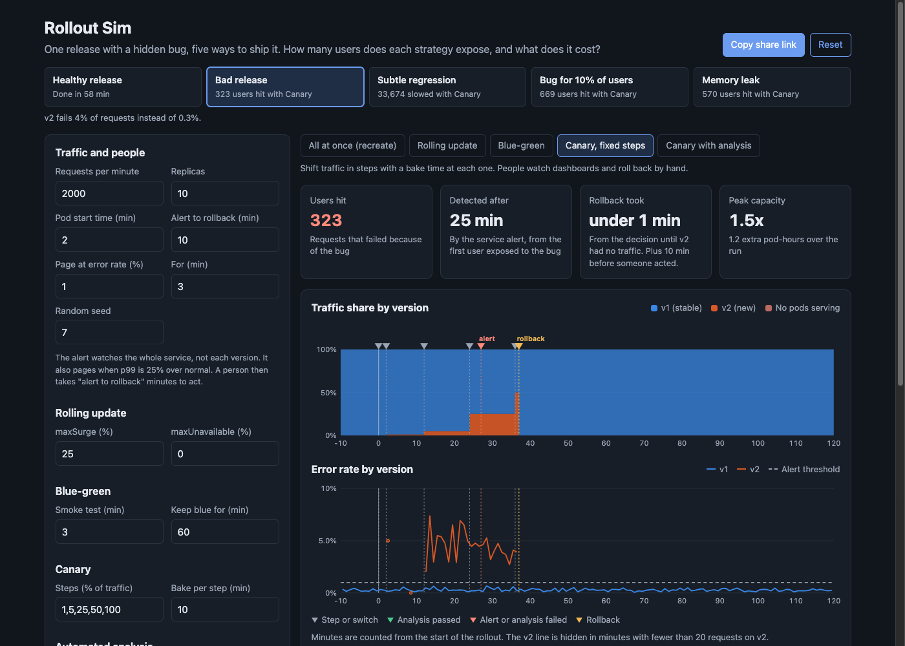

# Rollout Sim

A browser simulator that ships the same release five ways (recreate, rolling update, blue-green, canary with fixed steps, and canary with automated analysis) and shows what happens when the release has a hidden bug. Every minute of traffic is simulated: requests split between versions, errors and p99 sampled per version, an alert on the whole service, and a statistical canary check like the ones Argo Rollouts and Flagger run.



## Why

Choosing a deployment strategy is a trade between three costs: how many users a bad release reaches, how long a good release takes to ship, and how much spare capacity you pay for. Most teams pick one strategy and never see the other two costs. This puts all five side by side on the same release, the same traffic, and the same random seed.

Defaults: 2,000 requests per minute, 10 replicas, pods take 2 minutes to become ready, the on-call is paged when the service error rate is over 1% for 3 minutes, and it takes them 10 minutes to start a rollback. The bad release fails 4% of requests instead of 0.3%.

| Strategy | Users hit | Detected after | Rollback took | Healthy rollout | Peak capacity | Downtime |
|---|---|---|---|---|---|---|
| All at once (recreate) | 919 | 3 min | 2 min | 2 min | 1.0x | 4 min |
| Rolling update | 1,141 | 3 min | 8 min | 8 min | 1.3x | none |
| Blue-green | 966 | 3 min | under 1 min | 5 min | 2.0x | none |
| Canary, fixed steps | 323 | 25 min | under 1 min | 58 min | 1.5x | none |
| Canary with analysis | 3 | 10 min | under 1 min | 58 min | 1.1x | none |

- **Canary with analysis** exposes 3 users. The 1% step fails its check after 10 minutes (2.35% errors against 0.25%, z = 5.3) and rolls back in the same minute, before the service alert could ever fire. Across 200 seeds it catches this release at the 1% step 198 times.
- **Blue-green** has the fastest rollback mechanics (one traffic switch) but holds a second full stack: 2.0x capacity and 10.8 extra pod-hours on a healthy release, against 4.0 for the canaries.
- **Recreate** ships fastest and needs no extra pods, but every deploy and every rollback is a full outage while pods start: 4 minutes and about 7,900 failed requests here.
- **Fixed-step canaries** depend on someone noticing. At 1% and 5% the bug barely moves the service error rate, so the alert fires at 25%, and then the rollback waits on a person.

The other scenarios change the picture:

| Scenario | Recreate | Rolling | Blue-green | Canary | Canary + analysis |
|---|---|---|---|---|---|
| Subtle regression (p99 +40%), slowed requests | 26,213 | 38,082 | 26,275 | 33,674 | 6,412 |
| Bug for 10% of users | 414 | 577 | 409 | 669 | 4 |
| Memory leak after 20 minutes | 1,506 | 2,261 | 1,392 | 570 | 356 |

- A **latency-only regression** never moves the error rate. Only the p99 check or a p99 alert can see it.
- A **bug that hits 10% of users** pushes overall v2 errors to about 1.8%, so the service alert only fires once v2 has half the traffic. A fixed-step canary does worse than blue-green here because it sits at 25% and 50% for 20 minutes before anyone acts.
- The **memory leak** shows that bake time matters. With 10 minute bakes, analysis catches it at the 25% step. With 2 minute bakes the rollout finishes at minute 18, before the leak starts at minute 20, and 1,743 users are hit before the alert and a person roll it back.

## How it works

```
             per minute
 requests ──> router ──┬──> v1 pods: 0.3% errors, lognormal latency
 (Poisson)  (strategy) └──> v2 pods: scenario's bug and latency
                              │
          ┌───────────────────┴─────────────────────┐
  service alert (all traffic)            canary analysis (v2 vs v1)
  error rate or p99 over threshold       at the end of each bake:
  for N minutes, then a person           two-proportion z-test on errors,
  rolls back after a delay               confidence bound on p99 ratio,
                                         automatic rollback on a fail
```

- **Pods** have a start time before they are ready. Each strategy only creates and deletes pods and sets routing:
  - Recreate deletes every v1 pod, then starts v2. No pods serve traffic until v2 is ready.
  - Rolling update follows the Kubernetes Deployment rules: total pods never exceed replicas + maxSurge (rounded up) and ready pods never fall below replicas - maxUnavailable (rounded down). Rollback runs the same process in reverse.
  - Blue-green starts a full v2 stack, runs a smoke test with no user traffic, switches all traffic, and keeps blue for a set time. If blue is gone when the rollback starts, v1 has to be redeployed first.
  - Canary uses weighted routing (a mesh or ingress), so 1% needs only one pod. Stable stays at full size until the last step passes, as in Argo Rollouts by default.
- **Traffic** is Poisson around the requests-per-minute setting, split between versions by binomial sampling. Errors are binomial per version. A bug error is counted separately from the 0.3% background, which is how "users hit" is measured.
- **Latency** is lognormal (median 120 ms, sigma 0.5). Rather than sorting thousands of samples per minute, a measured p99 is the true p99 times a noise term from the asymptotic variance of a sample quantile, so small samples are noisy the way they are in practice.
- **Analysis**: at the end of each step's bake, a one-sided two-proportion z-test compares v2 errors with v1 over the same minutes. It fails if z is over the critical value for the significance level (2.33 at 1%) and v2 is at least 0.5 points worse. The p99 check fails if the lower confidence bound of the v2/v1 p99 ratio is above 1 + tolerance. At 100% there is no stable traffic left, so it compares with v1's last 10 minutes before the rollout.
- **Detection** is measured from the first minute users are exposed to the bug. "Rollback took" is from the decision to the first minute with no v2 traffic, so manual rollbacks also wait the human delay before that clock starts.

The engine is `src/rollout.js` with no DOM code. A 130 minute run takes under a millisecond, so the page simulates all five strategies on every scenario each time a setting changes.

`docs/argo-rollout-example.yaml` is the same canary-with-analysis strategy as a real Argo Rollouts manifest: a Rollout with weighted steps and an AnalysisTemplate whose Prometheus queries compute the same z statistic, the 0.5 point floor, and the p99 ratio. A test checks that its steps and thresholds match the simulator's defaults.

## What you see

- **Scenario picker** with the selected strategy's result on each scenario.
- **Strategy tabs** and **cards**: users hit, detection time, rollback time, and peak capacity.
- **Traffic share by version** as a stacked area, with outages shaded, and **error rate by version** on one axis with the alert threshold. Markers show steps, analysis passes and fails, alerts, and rollbacks. Hover for that minute's traffic, errors, p99, pods, and events.
- **Timeline** of every event for the selected strategy.
- **Comparison table** of all five strategies on the same release. Click a row to show it in the charts.

All settings live in the URL hash, so a scenario can be shared as a link.

## Run it

It is a static site with no build step and no dependencies. ES modules need a web server, so `file://` will not work. From this folder run:

```bash
python3 -m http.server 8000
```

Then open http://localhost:8000.

## Tests

```bash
npm test        # or: node --test
```

30 tests cover the engine:

- RNG determinism, a full run reproducible from the seed, Poisson and binomial means, normal CDF and inverse, the two-proportion z-test, and the p99 of a traffic mix.
- Each strategy's traffic schedule: recreate's outage window, rolling waves bounded by maxSurge and maxUnavailable, blue-green's switch and double capacity until blue is removed, and canary weights in step order with the bake time at each one.
- Rollback triggers: the alert needs the threshold held for N minutes, manual rollback starts exactly the human delay after it, analysis rolls back in the same minute it fails, and blue-green needs a redeploy once blue is scaled down.
- Scenarios: every strategy rolls back the bad release and none rolls back the healthy one, analysis catches the latency regression with the p99 check and the segment bug at 5% or less, and bake time decides whether analysis sees the memory leak.
- The analysis false-positive rate on a healthy release stays under 5% over 300 seeds (it is 3.1% over 1,000 seeds with 5 checks per rollout at 1% each).
- Blast radius on the bad release orders analysis < fixed canary < recreate, rolling, and blue-green on 25 seeds.
- Config round-trips through the URL hash, and the Argo manifest matches the simulator defaults.

## CI and deploy

`.github/workflows/ci.yml` runs the tests on every push and pull request. On push to `main` a second job publishes the site to GitHub Pages with `actions/upload-pages-artifact@v3` and `actions/deploy-pages@v4`. Set Pages to "GitHub Actions" as the source in the repo settings. The workflow has not been run locally.

## Production notes

- Analysis needs traffic. At 1% of 2,000 requests per minute the canary sees 200 requests in 10 minutes, which is enough for a 4% error rate but not for a 40% p99 regression. Low-traffic services need longer bakes, larger first steps, or synthetic load against the canary.
- Checking at every step multiplies false alarms: 5 checks at 1% each roll back about 3% of healthy releases here. Tune the significance level per metric, require a minimum effect size, and use Argo's inconclusive result for too little data instead of passing.
- Compare against a baseline started at the same time as the canary, not the long-running stable pods. Fresh pods have cold caches and a different age, which is exactly what a memory leak hides behind (Kayenta and Flagger both support this).
- Bugs that appear late need a bake time longer than their onset, or a post-promotion check. No amount of statistics catches a leak before it starts.
- Blue-green's 2x capacity is only for the deploy window if the cluster can scale nodes fast. Keeping blue for an hour is what makes rollback instant, and it is also what costs the most pod-hours.
- Database migrations break the instant-rollback story for every strategy. Ship them separately, backwards compatible, before the code that needs them.

## License

MIT. See [LICENSE](LICENSE).
